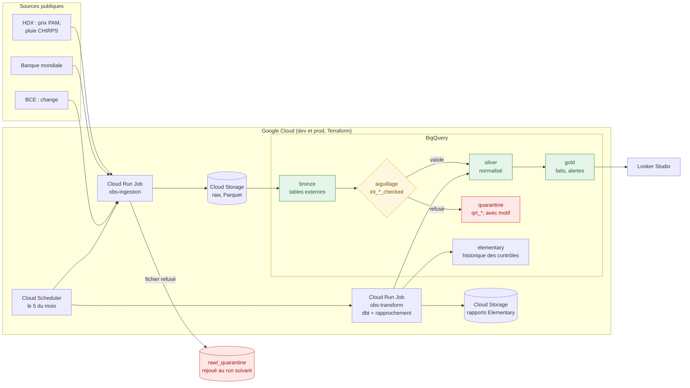

# Observatoire des prix alimentaires CEMAC

Pipeline batch mensuel sur Google Cloud qui rassemble les prix alimentaires publics des 6 pays de la CEMAC,
les normalise et signale les hausses anormales par marché et par produit.

> Projet personnel. Données publiques réelles (Programme alimentaire mondial via HDX : prix et pluviométrie CHIRPS,
> Banque mondiale, Banque centrale européenne). Aucune donnée n'est modifiée à la main : chaque règle de normalisation est versionnée.

## En bref

| | |
|---|---|
| **Données** | environ 240 000 prix mensuels, 211 marchés, 5 pays (2003 → 2026) ; 103 produits du PAM ramenés à 100 noms français ; pluie CHIRPS de 5 pays depuis 1981 |
| **Qualité** | 114 contrôles dbt à chaque exécution, dont 6 tests d'anomalie et de schéma Elementary ; prix recalculés en Python à l'identique (0 écart, ligne à ligne) ; pics isolés d'un mois mis en quarantaine (ADR-013) |
| **Alertes** | hausse anormale = z-score ET hausse sur 1 mois, seuils calibrés sur les données : environ 20 alertes par mois au Tchad, 6 au Cameroun, 3 en Centrafrique |
| **Plateforme** | GCP en Terraform (dev et prod) ; deux Cloud Run Jobs lancés chaque mois par Cloud Scheduler ; BigQuery bronze → silver → gold |
| **CI/CD** | 5 contrôles obligatoires sur chaque pull request ; déploiement dev avec test de fumée, puis prod après validation ; aucune clé de service (Workload Identity) |
| **Quarantaine** | à chaque étape, les données refusées partent dans une branche rouge avec leur motif, et reviennent seules une fois corrigées ; le run continue avec le reste (ADR-012) |
| **Décisions** | 13 ADR dans [`docs/decisions/`](docs/decisions/) |



---

## Sommaire

1. [Contexte et objectifs](#1-contexte-et-objectifs)
2. [État d'avancement](#2-état-davancement)
3. [Périmètre : ce que les données contiennent vraiment](#3-périmètre--ce-que-les-données-contiennent-vraiment)
4. [Sources de données](#4-sources-de-données)
5. [Architecture](#5-architecture)
6. [Modèle de données](#6-modèle-de-données)
7. [Normalisation et règles de qualité](#7-normalisation-et-règles-de-qualité)
8. [Infrastructure as Code et sécurité](#8-infrastructure-as-code-et-sécurité)
9. [CI/CD et déploiement](#9-cicd-et-déploiement)
10. [Démarrer](#10-démarrer)
11. [Arborescence](#11-arborescence)
12. [Livrables, critères de réussite, risques et coûts](#12-livrables-critères-de-réussite-risques-et-coûts)
13. [Sources et licence](#13-sources-et-licence)

---

## 1. Contexte et objectifs

**Le problème.** En Afrique centrale, le prix du manioc, du riz, de l'huile ou du poisson peut fortement varier
d'un mois à l'autre (pluies, routes coupées, crises, prix importés). Les relevés existent, mais ils sont publiés
dans des unités, des types de prix et des niveaux de détail différents, et personne ne signale simplement
qu'un prix dérape sur un marché.

**Les objectifs.**

1. Collecter automatiquement les prix publiés par le Programme alimentaire mondial (PAM) et des données de contexte
   (pluviométrie, inflation, population).
2. Normaliser : une unité de référence (kg ou litre), une monnaie de comparaison, un nom de produit et de marché uniques.
3. Détecter chaque mois les hausses anormales par rapport à l'historique du même marché.
4. Exposer le résultat dans un tableau de bord avec une carte des marchés.
5. Industrialiser : infrastructure en Terraform, déploiement par CI/CD, coût maîtrisé.

**Objectif personnel.** Pratiquer de bout en bout un entrepôt cloud (BigQuery), l'Infrastructure as Code
(Terraform) et une chaîne CI/CD sans clé de service.

## 2. État d'avancement

| Étape | Contenu | Statut |
|---|---|---|
| 1. Inventaire des données | Client HDX, profilage des 6 pays, fiche `docs/data_profile.md` | Terminée |
| 2. Socle Terraform | Projet GCP, buckets, datasets, comptes de service, budget, état distant | Terminée |
| 3. CI de base | ruff, pytest, gitleaks, `terraform plan` en commentaire, Workload Identity Federation | Terminée |
| 4. Ingestion | Job Python : prix PAM, pluie CHIRPS, Banque mondiale, change BCE ; empreinte, Parquet, journal | Terminée |
| 5. dbt silver et gold | 5A staging · 5B référentiels · 5C faits, dimensions, contrat | Terminée |
| 6. Contrôles et alertes | Contrôles warn / error, rapprochement Python, alertes | Terminée |
| 7. Déploiement continu | Image, Artifact Registry, Cloud Run Jobs, Scheduler, dev puis prod | Terminée |
| 8. Tableau de bord et documentation | Elementary, Data Studio, schémas, décisions | En cours (Elementary, tables du tableau de bord et pics isolés terminés ; reste la publication du rapport) |

## 3. Périmètre : ce que les données contiennent vraiment

Résultat de l'inventaire du 13 novembre 2026 (`make profile`). « Actif » = dernier relevé il y a 6 mois ou moins.

| Pays | Prix PAM | Période | Marchés | Produits | Lignes |
|---|---|---|---|---|---|
| Centrafrique (CAF) | actif | 2004-01 → 2026-10 | 41 | 39 | 31 733 |
| Cameroun (CMR) | actif | 2005-01 → 2026-09 | 83 | 55 | 77 711 |
| République du Congo (COG) | actif | 2011-01 → 2026-09 | 13 | 19 | 6 489 |
| Tchad (TCD) | actif | 2003-10 → 2026-06 | 74 | 34 | 134 716 |
| Gabon (GAB) | historique | 2007-01 → 2017-06 | 1 | 4 | 504 |
| Guinée équatoriale (GNQ) | absent | — | — | — | — |

**Deux niveaux de détail, jamais mélangés.**

- **Prix mensuels par marché** : 4 pays actifs, plus l'historique du Gabon.
- **Indicateurs nationaux annuels** (inflation, population) : les 6 pays, y compris la Guinée équatoriale.
- **Pluviométrie par district** (CHIRPS) : les 6 pays, depuis 1981. Les marchés sont rattachés à leur district à l'étape 5.

**Monnaie.** Les 6 pays utilisent le franc CFA d'Afrique centrale (XAF), à parité fixe avec l'euro.
Toutes les lignes du PAM sont en XAF. Les prix sont gardés en XAF et convertis en EUR et en USD pour comparer.

**Volume.** Environ 250 000 lignes de prix au total : un volume faible pour BigQuery.

### Ce que l'inventaire a révélé

| Constat | Ampleur | Décision |
|---|---|---|
| La plupart des unités sont des quantités : « 90 KG », « 400 G », « 1.5 L » | 20 unités sur 23 | Une règle : nombre × unité de base → prix au kg ou au litre |
| Catégorie `non-food` : salaires journaliers (unité `Day`), taux de change (`USD/LCU`)… | 9 produits, 553 lignes | Exclus des prix alimentaires |
| Animaux sur pied vendus à la tête (unité `Head`) | 6 692 lignes (Tchad) | Exclus de la première version : pas de prix au kg |
| Unités sans poids connu : `Sack`, `Package`, `Packet`, `Unit`, `1 piece` | environ 2 200 lignes | Mises de côté et listées, jamais devinées |
| Prix de gros et de détail mélangés | 19 295 lignes de gros (Cameroun) | Le type de prix fait partie du grain |
| Prix agrégés par le PAM (`priceflag` = `aggregate`) | 429 lignes (Centrafrique) | Conservés, identifiés par une colonne |
| Marchés sans coordonnées | 2 (Tchad) | Pas de pluie rattachée à ces marchés |
| Noms de produits en anglais du PAM, avec variantes (« Cassava (cossette) », plusieurs qualités de riz) | 103 produits | Table de correspondance vers un nom normalisé en français |
| Jeux FAOSTAT retirés de HDX | 0 jeu trouvé | Indicateurs nationaux pris à la source (section 4) |

**Répartition des lignes par catégorie (5 pays).**

| Catégorie | Produits | Lignes |
|---|---|---|
| cereals and tubers | 32 | 90 820 |
| vegetables and fruits | 16 | 51 698 |
| pulses and nuts | 12 | 30 197 |
| meat, fish and eggs | 20 | 29 901 |
| miscellaneous food | 3 | 27 170 |
| oil and fats | 9 | 19 174 |
| milk and dairy | 2 | 1 640 |
| non-food | 9 | 553 |

## 4. Sources de données

| Source | Contenu | Grain | Fréquence | Accès |
|---|---|---|---|---|
| PAM (WFP) sur HDX | Prix par marché, produit, unité, type de prix | Marché × produit × mois | Mensuelle | API CKAN de HDX, un CSV par pays |
| Banque mondiale | Inflation, population | Pays × année | Annuelle | API Indicators |
| Pluviométrie CHIRPS (PAM, HDX) | Pluie par décade, moyenne de long terme 1989-2018 et anomalies | District (admin2) × décade | Toutes les 2 semaines | API CKAN de HDX, un CSV par pays, depuis 1981 |
| Taux de change | XAF fixe face à l'euro (655,957) ; EUR/USD moyenne mensuelle | Mois | Mensuelle | API de la Banque centrale européenne |

**Règle d'ingestion.** Les sources publient un **historique complet** (le PAM republie tout l'historique d'un pays
à chaque mise à jour) : chaque run télécharge ce fichier, calcule son empreinte sha256 et ne l'écrit que s'il a changé.

```
gs://<bucket-raw>/_landing/wfp/country=COG/ingest_date=2026-11-13/<sha>.csv    original, tel quel
gs://<bucket-raw>/wfp/country=COG/ingest_date=2026-11-13/<sha>.parquet         typé, lu par bronze
```

- Le chemin dépend de l'empreinte : réécrire un fichier produit le même objet (idempotent).
- `meta.processed_files` mémorise les empreintes ; `meta.load_log` trace chaque fichier (succès, ignoré, échec).
- Tout est lu en texte puis converti explicitement ; une colonne absente ou une valeur illisible arrête
  le chargement de ce fichier au lieu de charger faux. Les montants sont en décimal, jamais en flottant.
- Les versions successives restent disponibles : silver retient la dernière par pays (`ingested_at`).

## 5. Architecture

### Flux des données (une fois par mois)

```
 Cloud Scheduler (le 5 du mois)
        │
        ▼
 ┌──────────────────────┐    ┌───────────────────────────────┐
 │ Job d'ingestion      │───▶│ Cloud Storage  (raw, Parquet) │
 │ Cloud Run Job        │    │ wfp/country=COG/              │
 │ HDX (prix, pluie),   │    │   ingest_date=…/<sha>.parquet │
 │ Banque mondiale, BCE │    └───────────────┬───────────────┘
 └──────────┬───────────┘                    │ tables externes bronze
            │ meta : load_log, sha256        ▼
            │                ┌────────────────────────────────────────┐
            └───────────────▶│ BigQuery                               │
                             │  bronze ──▶ silver ──▶ gold            │
                             │  (brut)    (normalisé)  (faits, dims,  │
                             │                          alertes)      │
                             │  meta : journal, contrôles             │
                             └──────────▲─────────────────┬───────────┘
                                        │                 │
                         Job dbt (Cloud Run Job)          ▼
                         build + tests + rapprochement  Looker Studio
                         + rapport Elementary           (carte, alertes)
```

### Flux de déploiement (à chaque modification du code)

```
 Pull request ──▶ CI : ruff, pytest, gitleaks, terraform plan (en commentaire),
                      dbt Slim CI sur le dataset ci, construction de l'image
        │
        ▼ fusion sur main
 CD : terraform apply (dev) ──▶ image étiquetée par commit ──▶ Artifact Registry
      ──▶ mise à jour des Cloud Run Jobs (dev) ──▶ run de fumée complet en dev
      ──▶ validation manuelle ──▶ mêmes étapes en prod

 Authentification GitHub ──▶ GCP : Workload Identity Federation (aucune clé JSON)
```

Pas de Cloud Composer : un Airflow managé est trop coûteux pour un traitement mensuel.
Cloud Scheduler et deux Cloud Run Jobs suffisent.

## 6. Modèle de données

| Dataset | Contenu | Construit par |
|---|---|---|
| `bronze` | Tables externes sur les Parquet de Cloud Storage (partitions Hive) : `wfp_prices`, `rainfall_adm2`, `world_bank_indicators`, `fx_eur_usd` | Job d'ingestion |
| `silver` | Types, unités, noms et marchés normalisés, lignes hors périmètre retirées | dbt |
| `gold` | Faits, dimensions et marts prêts à consommer | dbt |
| `meta` | Journal de chargement, fichiers traités, lignes mises de côté, résultats de contrôle | Ingestion, dbt |
| `quarantine` | Lignes et fichiers refusés, avec leur motif : la branche rouge (ADR-012) | dbt |

| Table (gold) | Grain : une ligne = | Contenu principal |
|---|---|---|
| `fct_price_monthly` | un marché, un produit, un type de prix, un mois | Prix en XAF par kg ou litre, en EUR et USD, unité d'origine, indicateur `aggregate` |
| `fct_country_indicator_yearly` | un pays, un indicateur, une année | Inflation, population |
| `dim_market` | un marché | Nom normalisé, pays, région, latitude, longitude |
| `dim_commodity` | un produit | Nom normalisé (FR), catégorie, unité de référence, noms d'origine |
| `dim_country` | un pays | Code ISO, statut des données (actif, historique, absent) |
| `dim_month` | un mois | Année, trimestre |
| `mart_price_metrics` | une série de prix, un mois | Variation sur 1 et 12 mois, moyenne et écart type des 24 mois précédents, z-score, niveau d'alerte |
| `mart_price_alerts` | un marché, un produit, un mois en alerte | Les lignes en alerte, avec les noms du marché, du produit et du pays |
| `mart_rain_vs_price` | un marché, un mois | Indice de prix au détail (médiane, 100 = prix habituel), alertes, pluie du district en % de la normale sur 1 et 3 mois |
| `mart_price_dashboard` | un prix mensuel | Prix, noms, position du marché et indicateurs : la source du tableau de bord |
| `mart_data_freshness` | un pays | Dernier relevé, pays actif en retard |
| `mart_pipeline_status` | une étape, une source, un résultat | Ce qui est passé (vert) et ce qui est en quarantaine (rouge), par motif (ADR-012) |

`fct_price_monthly` est partitionnée par mois et clusterisée par pays et produit. Elle est reconstruite
entièrement à chaque run : à ce volume, c'est quelques Mo de lecture, et c'est la seule façon de garantir qu'une
ligne partie en quarantaine disparaît aussi des faits (ADR-012).

## 7. Normalisation et règles de qualité

Chaque règle est une table de correspondance versionnée (seed dbt), jamais une correction à la main.

### Normalisation

| Problème | Règle | Où |
|---|---|---|
| Lignes hors périmètre | Exclure la catégorie `non-food` et l'unité `Head` ; les compter dans `meta` | silver |
| Unités en quantité (« 90 KG », « 400 G », « 1.5 L ») | Décomposer en nombre × unité de base (KG, G, L) ; prix ramené au kg ou au litre | silver |
| Unités sans poids (`Sack`, `Package`, `Packet`, `Unit`, `1 piece`) | Seed `unit_conversion` pour les cas connus par produit ; sinon ligne mise de côté et listée | silver |
| Variantes de noms de produits | Seed `commodity_mapping` : nom PAM → produit normalisé (FR) et catégorie | silver |
| Marchés en double ou mal orthographiés | Seed `market_mapping` + contrôle de distance entre coordonnées | silver |
| Détail et gros | Gardés séparés dans le grain, jamais moyennés ensemble | gold |
| Monnaie | XAF conservé ; EUR par parité fixe, USD par la série mensuelle | gold |

### Contrôles

| Contrôle | Gravité | Effet |
|---|---|---|
| Clé de grain unique, clés non nulles, relations vers les dimensions | error | Le run s'arrête |
| Contrat dbt sur `fct_price_monthly` (colonnes, types) | error | Le run s'arrête |
| Ligne invalide (prix négatif, devise, doublon) ou unité, produit, marché absent d'un référentiel | warn | Ligne en quarantaine avec son motif (`quarantine.qrt_*`) ; elle revient seule une fois corrigée (ADR-012) |
| Fichier source refusé (colonnes attendues absentes) | warn | Fichier en quarantaine (`raw/_quarantine/`), rejoué au run suivant (ADR-012) |
| Prix hors d'un facteur 10 de la médiane du produit dans le pays | warn | Ligne marquée suspecte, exclue des alertes |
| Pic isolé d'un mois : au moins 2,5 fois les deux mois voisins, qui se ressemblent (ex. sel en Centrafrique, décembre 2025) | warn | Ligne en quarantaine, motif `pic_isole_suspect` (ADR-013) |
| Aucun nouveau relevé depuis 3 mois pour un pays actif | warn | Signalé dans le tableau de bord |
| Prix moyen recalculé en Python égal à celui de dbt | error | Le run s'arrête |

### Règle d'alerte

Pour un marché, un produit et un type de prix, alerte quand le prix du mois est **à la fois** anormal par
rapport aux 24 mois précédents (z-score) **et** en forte hausse sur 1 mois :

| Niveau | z-score | Hausse sur 1 mois | Alertes par mois (36 derniers mois) |
|---|---|---|---|
| modérée | ≥ 2,5 | ≥ 25 % | Tchad 19,5 · Cameroun 6,5 · Centrafrique 2,8 · Congo 0,4 |
| forte | ≥ 3 | ≥ 40 % | Tchad 13,3 · Cameroun 3,4 · Centrafrique 1,7 · Congo 0,2 |

Le mois testé est exclu de la période de référence, les relevés suspects sont retirés, et une série de moins
de 12 mois de référence ne déclenche pas d'alerte. Les seuils viennent de la calibration sur les données
(ADR-009) : avec la règle « l'un ou l'autre » initialement prévue, le Tchad aurait reçu jusqu'à 176 alertes par mois.

## 8. Infrastructure as Code et sécurité

Toute l'infrastructure GCP est décrite en Terraform et créée uniquement par la CI, sauf le `bootstrap`
(bucket de l'état Terraform et accès GitHub), lancé une seule fois en local.

| Module | Ressources |
|---|---|
| `storage` | Bucket `raw` (Parquet), règles de cycle de vie |
| `bigquery` | Datasets `bronze`, `silver`, `gold`, `meta`, `ci` ; expiration des tables de `ci` |
| `iam` | Un compte de service par usage : ingestion, dbt, CI, tableau de bord |
| `artifact_registry` | Dépôt des images Docker |
| `run_jobs` | Cloud Run Jobs ingestion et dbt |
| `scheduler` | Déclenchement mensuel |
| `secrets` | Secret Manager |
| `billing_budget` | Budget mensuel, alertes à 50, 90 et 100 % |

`infra/envs/dev` et `infra/envs/prod` appellent les mêmes modules avec des variables différentes ;
l'état est stocké dans un bucket dédié, un préfixe par environnement.

| Compte de service | Lit | Écrit |
|---|---|---|
| ingestion | sources publiques | bucket raw, datasets bronze et meta |
| dbt | bronze, seeds | silver, gold, meta |
| ci | dev en lecture | dataset ci uniquement |
| dashboard | gold | rien |

- Aucune clé JSON de compte de service : GitHub Actions s'authentifie par Workload Identity Federation,
  limitée à ce dépôt et à la branche `main` pour l'écriture.
- Aucun secret dans Git ; analyse automatique des secrets dans la CI.
- Plafond d'octets facturés par requête dans dbt.

## 9. CI/CD et déploiement

**Sur chaque pull request** (`.github/workflows/ci.yml` : étape 3, dbt depuis l'étape 5, image depuis l'étape 7).

1. Lint : `ruff`, `sqlfluff`, `terraform fmt` et `terraform validate`.
2. Tests `pytest` : client HDX, profilage, conversion d'unités, empreinte, règle d'alerte.
3. `terraform plan` sur dev, publié en commentaire de la pull request.
4. `dbt build` sur le dataset `ci` (Slim CI : modèles modifiés et leurs descendants, parents inchangés lus
   dans dev avec `--defer`). Identité `sa-dbt-ci`, qui ne peut écrire que dans `ci` (ADR-008).
5. Construction de l'image Docker et démarrage à vide, recherche de secrets.

**Après fusion sur `main`** (`.github/workflows/cd.yml`, ADR-010).

1. dev : `terraform apply`, image étiquetée avec le numéro de commit et poussée dans Artifact Registry,
   mise à jour des Cloud Run Jobs `obs-ingestion` et `obs-transform`.
2. Test de fumée : les deux jobs sont exécutés jusqu'au bout en dev (ingestion, dbt avec ses contrôles,
   rapprochement Python). Le moindre échec arrête le déploiement.
3. Validation manuelle (environnement GitHub `prod`), puis `terraform apply` sur prod, copie de **la même image**
   et exécution complète.

**Retour arrière.** Lancer `cd` à la main avec `image_sha` = un commit déjà déployé : son image est remise en
place sans reconstruction. Les données se reconstruisent depuis `bronze`, qui n'est jamais modifié par dbt.

**Exécution mensuelle.** Cloud Scheduler lance l'ingestion le 5 du mois à 3 h et la transformation à 5 h
(heure de Paris), en prod. Chaque exécution est idempotente : relancer un job ne crée jamais de doublon.

## 10. Démarrer

Prérequis : WSL Ubuntu (ou Linux), Python 3.11+, `make`. Pour l'étape 2 : `gcloud` et `terraform`.

```bash
cp .env.example .env
make install      # environnement Python local
make test         # tests unitaires
make profile      # étape 1 : inventaire des 6 pays sur HDX → docs/data_profile.md
make ingest-local # étape 4 : ingestion dans data/lake, sans accès GCP
make ingest       # étape 4 : ingestion vers le bucket raw, meta et bronze (projet dev, identifiants gcloud)
make dbt-deps     # étape 5 : paquets dbt
make dbt-build    # seeds, modèles silver/gold et tests sur dev
make dbt-freshness
make dbt-docs     # documentation et lineage sur http://localhost:8081
make reconcile    # étape 6 : prix recalculés en Python depuis bronze, comparés à dbt
make elementary-report   # étape 8 : rapport Elementary dans data/elementary/report.html
make run          # tout le pipeline sur dev : ingestion, dbt, rapprochement
```

**Pas de backfill mois par mois.** Les sources republient leur historique complet à chaque mise à jour, et
silver comme gold sont reconstruits depuis bronze à chaque run (ADR-005, ADR-012). Rejouer le passé revient donc
à relancer le pipeline : `make run` en local, ou une exécution des jobs Cloud Run.

En dev et en prod, rien n'est lancé à la main : le CD déploie à chaque fusion sur `main`, et Cloud Scheduler
exécute le pipeline chaque mois (section 9).

Sorties de l'inventaire : `docs/data_profile.md` (versionné), `data/profile/units.csv`,
`data/profile/commodities.csv` et `data/profile/profile.json` (non versionnés).

## 11. Arborescence

```
.
├── .github/workflows/     # ci.yml, cd.yml
├── infra/                 # Terraform : bootstrap/, modules/, envs/dev, envs/prod
├── Dockerfile             # image unique du pipeline (ingestion, dbt, rapprochement, rapport)
├── pipeline/              # point d'entrée des Cloud Run Jobs, envoi du rapport Elementary
├── ingestion/             # job d'ingestion Python : src/ingestion, tests/
├── dbt/                   # transformations : seeds, models (staging, intermediate, marts), macros, tests
├── quality/               # rapprochement Python indépendant de dbt
├── reference/             # relecture versionnée des référentiels, coordonnées corrigées
├── scripts/               # inventaire, génération des référentiels, rattachement des marchés
├── dashboard/             # tableau de bord Looker Studio
└── docs/                  # data_profile.md, dashboard.md, décisions (ADR)
```

## 12. Livrables, critères de réussite, risques et coûts

**Critères de réussite.**

- `terraform destroy` puis `terraform apply` recréent tout, sans action manuelle.
- Relancer l'ingestion d'un mois déjà chargé laisse le nombre de lignes inchangé.
- Aucune clé de compte de service dans le dépôt ni dans GitHub.
- Toutes les unités et tous les produits des 4 pays actifs sont reconnus, ou listés dans `meta`.
- Coût mensuel constaté inférieur au budget fixé.

**Hors périmètre de la première version.** Temps réel, collecte de prix sur le terrain, prévision des prix,
API, assistant en langage naturel, animaux sur pied.

| Risque | Parade |
|---|---|
| Un pays cesse de publier | Statut actif / historique recalculé à chaque run, affiché dans le tableau de bord |
| Format des fichiers modifié par l'éditeur | Contrôle des colonnes attendues ; le run s'arrête au lieu de charger faux |
| Unités impossibles à convertir | Lignes mises de côté et listées, jamais devinées |
| Une source disparaît (cas de FAOSTAT sur HDX) | Inventaire relancé avant chaque évolution ; sources remplaçables |
| Facture GCP | Budget et alertes dès l'étape 2, plafond d'octets par requête, pas de Composer |

**Coût.** Environ 250 000 lignes : le projet doit tenir dans l'offre gratuite de BigQuery et de Cloud Run,
à vérifier sur la page de tarification de Google Cloud avant l'étape 2. Coût réel suivi dans `docs/cost.md`.

## 13. Sources et licence

- Prix : Programme alimentaire mondial (WFP), jeux « Food Prices » par pays sur
  [HDX](https://data.humdata.org/dataset/wfp-food-prices-for-chad) — licence Creative Commons Attribution
  pour les organisations intergouvernementales (CC BY-IGO).
- Indicateurs nationaux : Banque mondiale (API Indicators).
- Pluviométrie : CHIRPS v2 (Climate Hazards Center, UC Santa Barbara), agrégée par district par le PAM, sur HDX
  — licence Creative Commons Attribution.
- Code : licence à définir.
